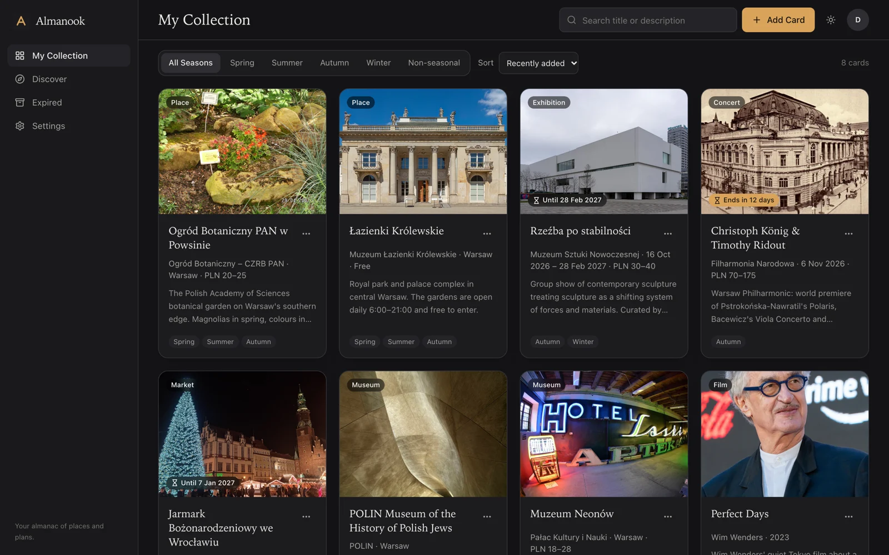
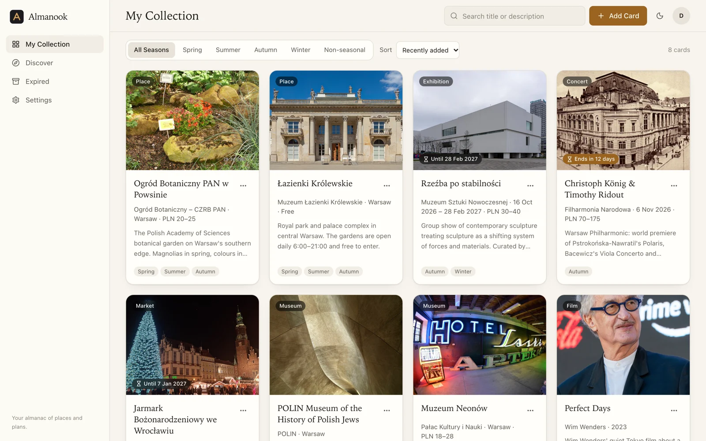
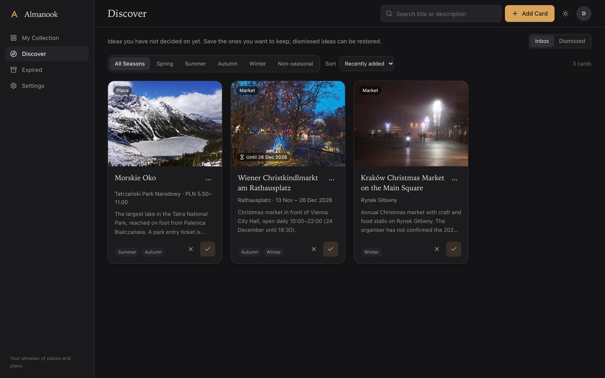
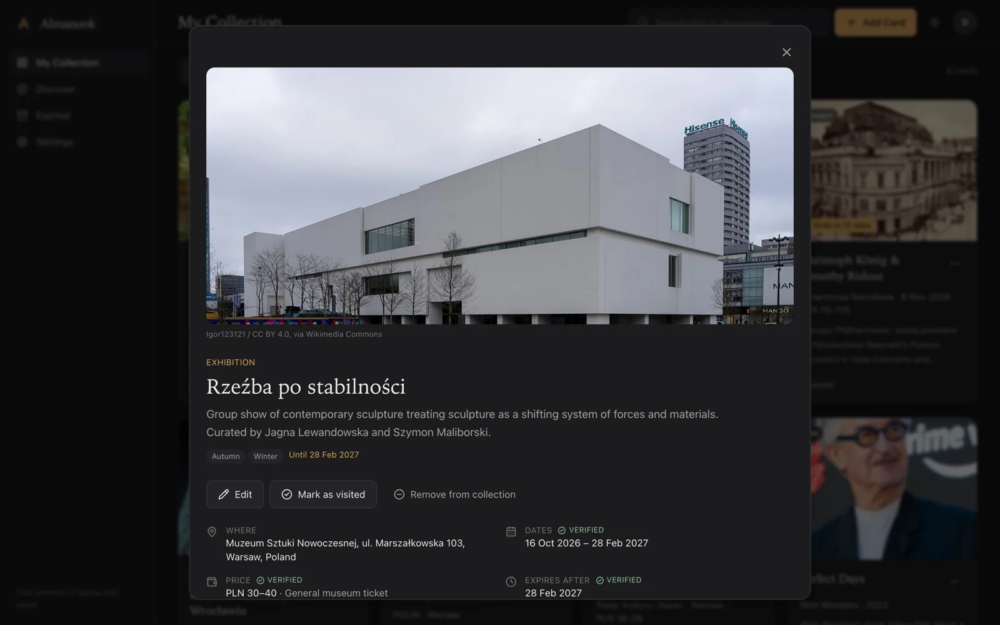
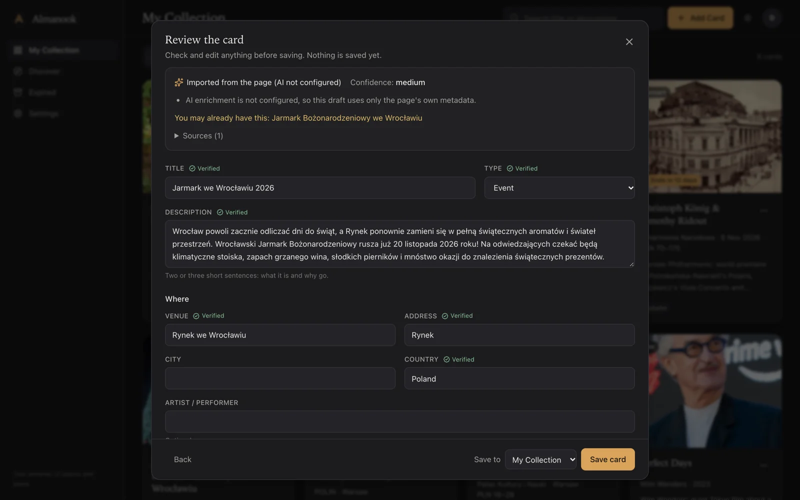
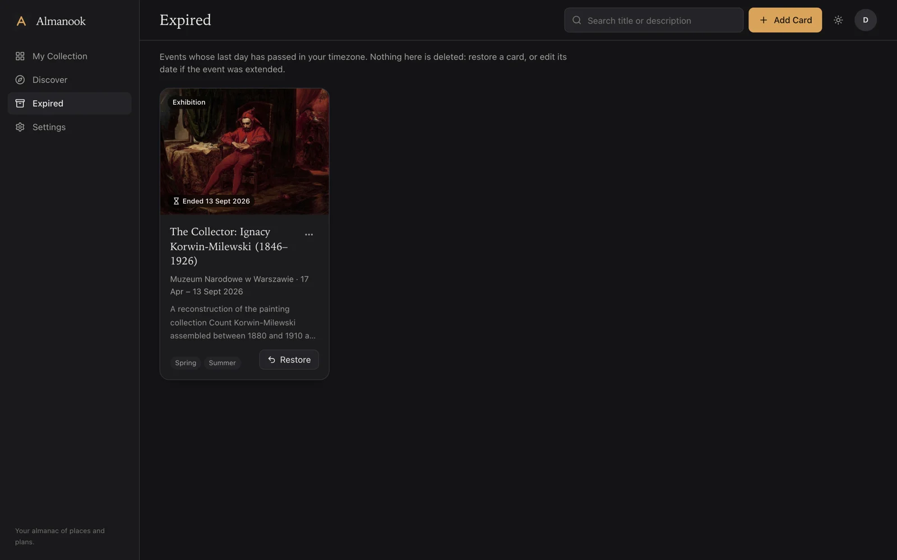
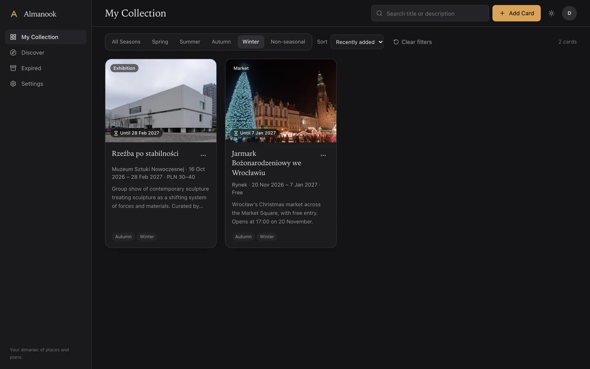
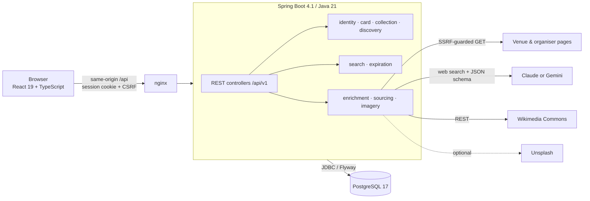
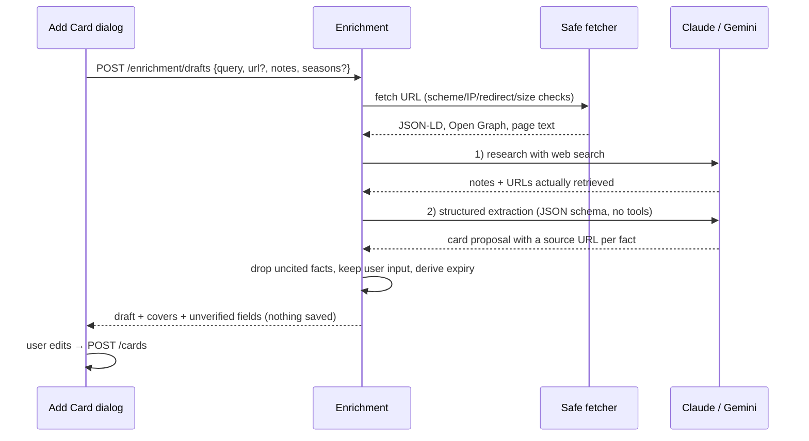
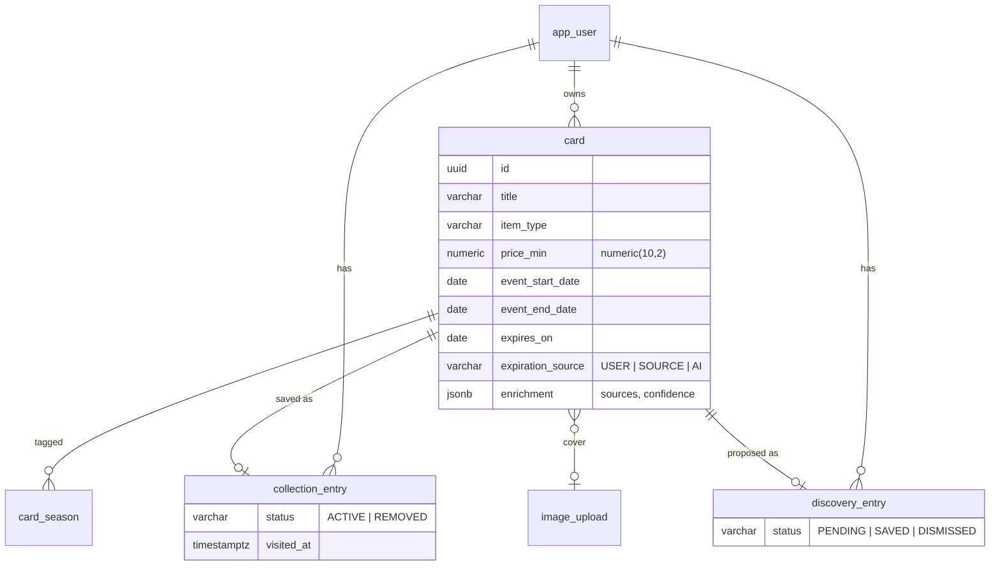

<p align="center">
  
</p>

<h1 align="center">Almanook</h1>

<p align="center"><em>Your almanac of places and plans.</em></p>

<p align="center">
  <a href="https://github.com/anniigr/almanook/actions/workflows/ci.yml"></a>
  
  
  
  
</p>

Almanook is a private, image-led collection of the places and experiences you want to get to:
gardens and landmarks, exhibitions, opera and concerts, Christmas markets, films, restaurants and
trips abroad. Paste a name or a link and Almanook prepares an informative card (cover, venue, dates,
price) from **real sources**. It tracks which ideas suit which **season**, moves finished events to an
**Expired** archive instead of deleting them, and keeps undecided ideas in a separate **Discover**
inbox.

The primary market is Poland (Warsaw, Kraków, Wrocław…), but Almanook works for places and events
anywhere.



<table>
  <tr>
    <td><br><sub>Light theme</sub></td>
    <td><br><sub>Discover inbox: Save ✓ / Dismiss ✕ on every idea</sub></td>
  </tr>
  <tr>
    <td><br><sub>Card detail: provenance badges and image attribution</sub></td>
    <td><br><sub>Draft imported from a real event page (no AI key configured)</sub></td>
  </tr>
  <tr>
    <td><br><sub>Expired archive with Restore</sub></td>
    <td><br><sub>Season filter: Winter</sub></td>
  </tr>
</table>

All screenshots are of the running application, seeded by
[`frontend/scripts/seed-demo.mjs`](frontend/scripts/seed-demo.mjs) with facts checked against
official pages on 2026-10-25 (sources are stored with each card). Covers are Wikimedia Commons images
found by the app's own image search and shown with their licence attribution.

## Why Almanook

The [market research](docs/market-research.md) found three families of tools, and each leaves part
of the job undone. Place savers (Google Maps lists, Mapstr) have no dates. Event apps (Soonlist,
Eventbrite, Fever, Going.) cover only events, often only their own inventory. Visual bookmarking
tools (Pinterest, mymind, Raindrop) have no venue, date or price structure. Almanook combines a
visual grid with a structured, time-aware card. Naming and positioning:
[brand-and-product-positioning.md](docs/brand-and-product-positioning.md).

## Features

- **Responsive card grid:** four columns on wide desktops, three on medium screens, two on phones
  (one below 360 px). Image-led cards with lazy-loaded covers and infinite scroll.
- **Information by item type:** exhibitions show venue, dates and price; places show location and
  price; films show director and year plus a *Watched* status, never an invented end date.
- **Seasons:** a card can belong to several seasons. *All Seasons* shows everything; a single season
  shows only cards tagged with it; *Non-seasonal* shows untagged cards.
- **Search and sorting:** search titles and descriptions; sort by recently added, alphabetically or
  by event date; a clear-filters action; filters live in the URL.
- **Expiration as a domain feature:** start date, end date and expiry are separate fields, each with
  provenance (*you*, *verified from source*, *AI suggestion*). An event ending on 24 December stays
  active through that whole local day in your timezone (default `Europe/Warsaw`). Expiry is computed
  at query time, so it stays correct after downtime. Expired cards are archived, never deleted, and
  move back when you clear or extend the date.
- **Discover inbox:** unsaved ideas with Save and Dismiss on the right. Saving never creates a
  duplicate, and dismissing can be undone.
- **Add Card:** type a name, paste a URL, add a note, choose seasons or an expiry, then *Generate
  card*, or *Create manually*. Every draft is shown for review and editing before it is saved, and an
  edited value is saved as yours.
- **AI enrichment (Claude or Gemini), grounded and honest:** web research first, then schema-constrained
  extraction. Dates, prices, addresses and opening hours are kept only if they cite a page that was
  actually retrieved; otherwise they are left empty and listed as *unverified*. Your input is never
  overwritten: a better official name is offered as a suggestion.
- **Without an API key the app is fully usable:** manual cards, plus *BASIC* import that reads the
  page's own schema.org JSON-LD and Open Graph metadata.
- **Covers:** the official page image first, then openly licensed Wikimedia Commons photos with
  attribution, then Unsplash (optional key), otherwise a neutral placeholder. You can also paste an
  image URL (checked server-side) or upload a JPEG, PNG or WebP of up to 5 MiB.
- **Dark (default) and light themes:** semantic design tokens, OS preference respected until you
  choose, and the choice persisted locally and in your account.
- **Accessibility:** keyboard navigation, visible focus, Radix dialogs and menus, native radio
  groups, skip link, labelled icon buttons with tooltips, and undo instead of blocking confirmations
  where an action can be reversed.

## Architecture

A **modular monolith**: one Spring Boot application whose modules are Java packages, with the
boundaries verified by Spring Modulith in the test suite. A React SPA is served by nginx on the same
origin. Details: [docs/architecture.md](docs/architecture.md) and the [ADRs](docs/adr).





### Data model



Card facts and personal state are separate tables. A composite foreign key guarantees that entries
belong to the card's owner, partial unique indexes prevent duplicate URLs, and `CHECK` constraints
keep provenance and status timestamps consistent. Full rationale: [docs/data-model.md](docs/data-model.md).

## Technology

| Layer | Stack |
|---|---|
| Backend | Java 21, Spring Boot 4.1.2 (Web MVC, Security 7, Data JPA / Hibernate 7, Validation, Actuator), Spring Modulith 2.1, Flyway, springdoc-openapi 3.2 |
| AI and images | `com.anthropic:anthropic-java` 3.3 (Claude, web search tool, structured outputs) or the Gemini Interactions API over the JDK HTTP client (Google Search and URL context grounding, JSON schema output), Wikimedia Commons API, Unsplash API (optional) |
| Fetching | Apache HttpClient 5 with a validating DNS resolver, jsoup |
| Database | PostgreSQL 17 (`pg_trgm` search indexes) |
| Frontend | React 19, TypeScript (strict), Vite 8, Tailwind CSS 4, TanStack Query 5, React Router 8, Radix UI, lucide icons |
| Quality | JUnit 5, AssertJ, Mockito, Testcontainers, WireMock, Vitest, Testing Library, MSW, Playwright, Spotless (Palantir), oxlint, Prettier, JaCoCo |
| Delivery | Docker Compose, multi-stage images (layered Spring Boot jar, nginx), GitHub Actions |

## API overview

Versioned under `/api/v1`, with RFC 9457 problem responses. The full reference is in
[docs/api.md](docs/api.md), and OpenAPI is live at `/v3/api-docs` with Swagger UI at
`/swagger-ui.html`.

| Area | Endpoints |
|---|---|
| Auth and preferences | `GET /auth/csrf`, `POST /auth/register`, `POST /auth/login`, `POST /auth/logout`, `GET /me`, `PUT /me/preferences` |
| Cards | `POST /cards`, `GET /cards`, `GET /cards/{id}`, `PUT /cards/{id}`, `PATCH /cards/{id}/expiration`, `DELETE /cards/{id}` |
| Collection | `GET /collection?q=&season=&sort=&page=&size=`, `PUT /collection/{cardId}`, `DELETE /collection/{cardId}`, `PATCH /collection/{cardId}` |
| Discover | `GET /discover?status=`, `POST /discover/{cardId}/save`, `/dismiss`, `/restore` |
| Archive | `GET /expired` |
| Enrichment | `GET /enrichment/status`, `POST /enrichment/drafts` |
| Images | `POST /images`, `GET /images/{id}`, `POST /images/candidates`, `POST /images/check-url`, `POST /images/unsplash-selection` |

## Running locally

Prerequisites: Docker, plus JDK 21 and Node 22 for the development loop.

```bash
git clone https://github.com/anniigr/almanook.git && cd almanook
make env          # creates .env from .env.example; set the passwords (and keys, if you have them)
make up           # PostgreSQL + backend + web, built from source
open http://localhost:3000
```

With `ALMANOOK_DEMO_USER_ENABLED=true` you can sign in as `demo@almanook.app` with the password from
`.env`, or create an account on the sign-in page. To load the demo cards shown above:

```bash
cd frontend && npm ci
BASE_URL=http://localhost:3000 DEMO_PASSWORD=<ALMANOOK_DEMO_USER_PASSWORD> node scripts/seed-demo.mjs
```

### Development loop

```bash
make infra        # PostgreSQL only
make backend      # Spring Boot on :8080; Flyway migrations run on start-up
make frontend     # Vite on http://localhost:5173, proxying /api to the backend
```

| Command | What it does |
|---|---|
| `make test` | Backend unit and integration tests (Testcontainers, needs Docker), then frontend lint, type check and component tests |
| `make e2e` | Playwright against a running stack (`E2E_BASE_URL`, default `http://localhost:3000`) |
| `make build` | Production artifacts: `backend/target/almanook.jar` and `frontend/dist` |
| `make lint` / `make fmt` | Formatting and lint checks / apply formatting |
| `make reset` | Stop the stack and delete the database volume |

## Configuration

Everything is configured through environment variables, documented in
[`.env.example`](.env.example). The important ones:

| Variable | Purpose |
|---|---|
| `POSTGRES_*`, `SPRING_DATASOURCE_*` | Database |
| `ANTHROPIC_API_KEY` or `GEMINI_API_KEY` | Enables AI enrichment with Claude or Gemini. If both are empty, AI is off and the UI explains why. |
| `ALMANOOK_AI_PROVIDER` | `auto` (default: Anthropic if its key is set, otherwise Gemini), `anthropic`, `gemini` or `none` |
| `ALMANOOK_AI_MODEL` / `ALMANOOK_AI_EFFORT` | Claude: default `claude-opus-5-5` at `low` effort. Can be switched to, for example, `claude-sonnet-5-5` or `claude-haiku-5-5` to reduce cost. |
| `ALMANOOK_AI_REFUSAL_FALLBACK` | Sends Claude's server-side refusal fallback (beta). Set `false` if your account or gateway rejects it. |
| `ALMANOOK_GEMINI_MODEL` / `ALMANOOK_GEMINI_THINKING_LEVEL` | Gemini: default `gemini-3.5-flash-lite` at thinking level `low`. A key is free to create at [Google AI Studio](https://aistudio.google.com/apikey). Google Search grounding needs a paid-tier key; on the free tier the app researches with URL context only and says so in the logs. |
| `UNSPLASH_ACCESS_KEY` | Optional third image source |
| `ALMANOOK_DEMO_USER_*` | Local single-user convenience. Do not enable on a public server. |
| `ALMANOOK_SECURE_COOKIES` | `true` behind HTTPS |
| `POSTGRES_PORT`, `BACKEND_PORT`, `WEB_PORT`, `ALMANOOK_BACKEND_URL` | Host ports and the dev proxy target |

## Testing

| Suite | Tool | Count | Command |
|---|---|---|---|
| Backend unit, architecture and contract | JUnit 5, AssertJ, Spring Modulith, WireMock with the real Anthropic SDK and a WireMock Gemini Interactions API, in-process HTTP server for SSRF | 126 | `cd backend && ./mvnw test` |
| Backend integration | Spring Boot, Testcontainers PostgreSQL 17, real HTTP client with cookie jar and CSRF | 42 | `cd backend && ./mvnw verify` |
| Frontend components | Vitest, Testing Library, MSW | 26 | `cd frontend && npm test` |
| End to end | Playwright against the Docker Compose stack | 3 journeys | `make e2e` |

Highlights: expiry at the exact local midnight, across both 2026 DST changes and at UTC+14 and
UTC−11; the season semantics; duplicate prevention under repeated saves; cross-user isolation on
every endpoint (404, not 403); a 52-case SSRF table (encoded IPs, IPv6-mapped metadata addresses,
redirect chains to `169.254.169.254`); uncited AI facts dropped; refusal, truncation, malformed JSON
and 401/5xx from the provider never becoming a fake draft. Strategy:
[docs/testing-strategy.md](docs/testing-strategy.md). CI runs all suites on every push and pull
request.

## Security

- Session cookies (`HttpOnly`, `SameSite=Lax`) with Spring Security's SPA CSRF protection, BCrypt
  passwords, and the session id rotated on login.
- Every query is scoped to the authenticated user; no endpoint accepts a user id.
- Outbound requests to user URLs go through one fetcher. It allows only http and https on ports 80
  and 443, blocks private, loopback, link-local, metadata and other reserved addresses (including
  IPv4-mapped forms), pins the connection to the validated IP to defeat DNS rebinding, re-checks
  every redirect (at most 5), and enforces timeouts, a streaming size cap and a content-type
  allow-list.
- Retrieved page text reaches the model only as delimited, untrusted data; the extraction step has
  no tools.
- Uploads are verified by magic bytes, limited to 5 MiB, private and served with `nosniff`.
- CSP, `X-Frame-Options: DENY` and Referrer-Policy headers; problem responses never include
  internals.

Threat model and details: [docs/security.md](docs/security.md).

## Known limitations

- **Neither AI integration has been exercised against the real API in this repository.** No API key
  was available while building them. The Claude adapter is tested through the official SDK against
  recorded-shape responses (WireMock); the Gemini adapter is tested against WireMock responses
  shaped after Google's Interactions API documentation, which does not publish every field of the
  tool-result steps, so the parser reads them defensively. The rest of the app was verified end to
  end without a key. Setting `GEMINI_API_KEY` or `ANTHROPIC_API_KEY` is the remaining step to verify
  enrichment live.
- Automatic Wikimedia covers come from a keyword search. They are correctly licensed and attributed
  but can be only loosely related (for example, a building photo for an exhibition). The cover picker
  lets you choose another.
- Many sites, ticketing platforms included, publish no schema.org data, so BASIC import (without AI)
  often yields only a title and description.
- No rate limiting on login and enrichment yet; sessions are in memory (a restart signs users out);
  no password reset or email verification.
- On phones the header search box is hidden; filters, sorting and navigation work.
- The interface is in English; card content keeps local names.

## Roadmap

- Spring Session JDBC, bucket4j rate limits, password reset.
- "Ends this week" digest (a scheduled job for notifications only; expiry already works without it).
- Map view using the stored coordinates.
- Share-sheet/bookmarklet capture and import from Google Maps lists.
- Polish UI translation.
- A second AI provider adapter behind the same `AiResearchProvider` port.

## Documentation

[Market research](docs/market-research.md) · [Brand and positioning](docs/brand-and-product-positioning.md) ·
[Architecture](docs/architecture.md) · [Data model](docs/data-model.md) · [API](docs/api.md) ·
[Security](docs/security.md) · [Testing strategy](docs/testing-strategy.md) ·
[Implementation plan](docs/implementation-plan.md) · [ADRs](docs/adr)

## License

[MIT](LICENSE) © 2026 Anna Granos. Screenshot covers are from Wikimedia Commons under the licences
credited in the app.
