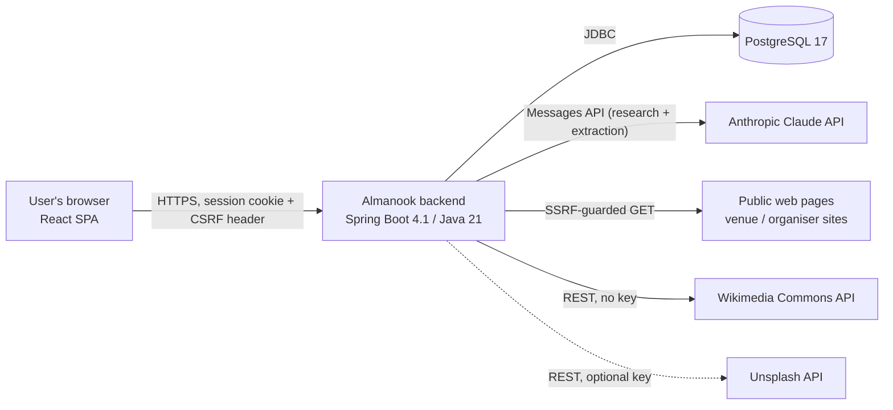
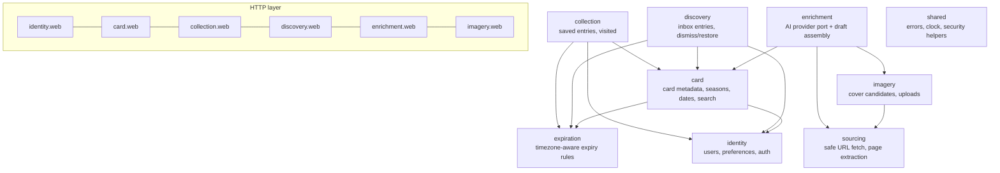
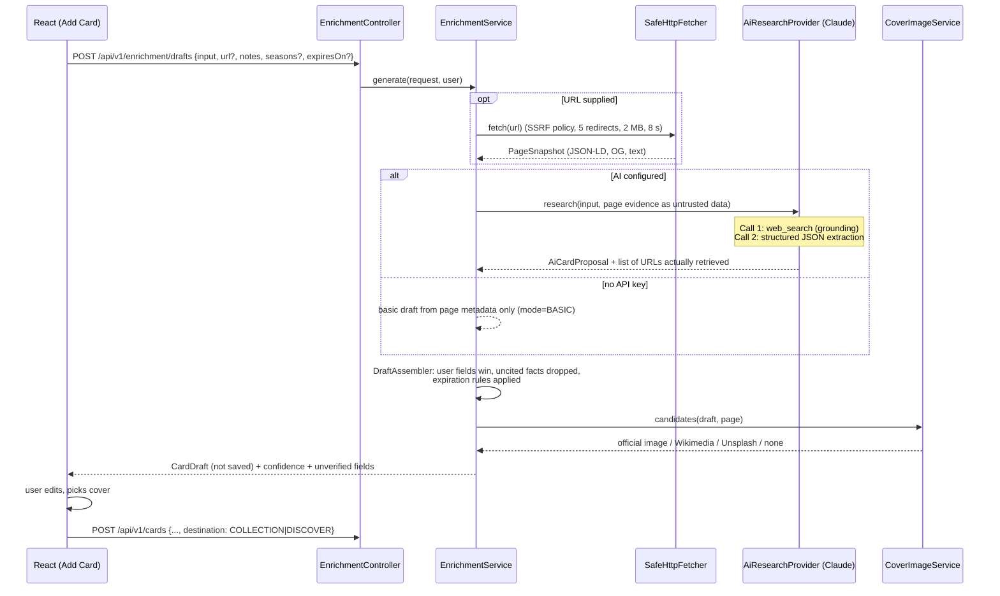

# Architecture

Almanook is a **modular monolith**: one deployable Spring Boot application with a React single-page
client. Modules are Java packages under `app.almanook.*`, and the dependency rules between them are
verified by a Spring Modulith test (`ModularityTest`), so the boundaries are enforced by the build
rather than by convention.

## System context



The browser never talks to Claude, Wikimedia or Unsplash directly for data. External provider
credentials live only in the backend environment. Cover images selected from external providers are
rendered by the browser from the provider's own URL (hotlinking is what Unsplash's API guidelines
require and what Wikimedia permits), and user uploads are served by the backend.

## Modules



| Module | Responsibility | Key types |
|---|---|---|
| `identity` | Registration, login/logout, current user, preferences (theme, language, timezone). Owns the `app_user` table. | `UserAccount`, `PreferencesService`, `CurrentUser` |
| `card` | Card metadata: title, description, type, venue, location, price, event dates, expiration and its provenance, seasons, cover. Ownership checks. Search/filter specification. | `Card`, `CardService`, `CardSearchCriteria`, `Season`, `ItemType` |
| `collection` | The user's saved cards: save (idempotent), remove (soft, undoable), visited/watched, personal note, active collection query, expired archive query. | `CollectionEntry`, `CollectionService` |
| `discovery` | The Discover inbox of unsaved ideas: add, dismiss, restore, promote to collection without duplicating. | `DiscoveryEntry`, `DiscoveryService` |
| `expiration` | Pure domain logic: "is this card expired today in this timezone?", default expiration for temporary item types, provenance precedence. No persistence. | `ExpirationPolicy`, `ExpirationSource` |
| `sourcing` | Retrieves untrusted URLs safely (scheme/host/IP validation on every redirect hop, timeouts, size and content-type limits) and extracts structured facts: `<title>`, Open Graph, schema.org JSON-LD (`Event`, `Place`, `Museum`, `Offer`...), readable text. | `SafeHttpFetcher`, `UrlSafetyPolicy`, `PageExtractor`, `PageSnapshot` |
| `enrichment` | Turns user input (name / URL / note) into a **draft** (never persisted by itself). Defines the `AiResearchProvider` port; the Anthropic adapter implements it. Validates the model's structured output, discards facts whose cited source was not actually retrieved, and never overwrites user-entered fields. | `EnrichmentService`, `AiResearchProvider`, `AnthropicResearchProvider`, `DraftAssembler`, `CardDraft` |
| `imagery` | Cover candidates (official page image → Wikimedia Commons → Unsplash → none), attribution metadata, user uploads stored in PostgreSQL. | `CoverImageService`, `ImageCandidateProvider`, `UploadedImage` |
| `shared` | RFC 9457 problem responses, `Clock` bean, pagination DTO. | `ApiExceptionHandler`, `PageResponse` |

Each module keeps the same internal layering:

```
<module>/
  web/            controllers + request/response DTOs (records, Bean Validation)
  <root>          application services (transaction boundaries) + domain types
  persistence     Spring Data repositories (package-private where possible)
  provider/       adapters to external systems (only enrichment, imagery, sourcing)
```

Controllers never touch repositories; provider adapters never touch the domain model directly — they
return provider-neutral value objects that the application service validates.

## Key flows

### Generate a card draft



Generation is isolated from CRUD: `POST /api/v1/cards` has no dependency on the AI provider, so
provider outages cannot break the collection.

### Expiration

Expiration is **computed at query time** — there is no "expired" flag in the database. The collection
query receives `today` computed in Java as `LocalDate.now(clock.withZone(user.timezone))`, and a card
is expired when `expires_on < today`. An event ending on 2026-12-24 is therefore active for the whole
local day of 24 December and appears in the archive from 00:00 on 25 December in the user's zone.
Editing the date to the future returns the card to the active collection with no extra state to
reconcile. See [ADR-0004](adr/0004-query-time-expiration.md).

## Security architecture (summary)

* Session-cookie authentication (`JSESSIONID`, `HttpOnly`, `SameSite=Lax`) with Spring Security's SPA
  CSRF protection (`XSRF-TOKEN` cookie → `X-XSRF-TOKEN` header). Passwords hashed with BCrypt
  (delegating encoder).
* Every query is scoped by the authenticated principal's id; no endpoint accepts a user id.
* Outbound fetches go through `SafeHttpFetcher` only. Details in [security.md](security.md).

## Technology choices

| Concern | Choice | Why |
|---|---|---|
| Language/runtime | Java 21 LTS | Supported by Spring Boot 4.1 and all dependencies; the LTS installed on the development machine and in CI. Java 25 would also work; nothing in the code depends on 25-only features. |
| Framework | Spring Boot 4.1.2 (Spring Framework 7, Spring Security 7, Hibernate 7) | Current stable Boot line (4.2 is still RC as of 2026-10-25). |
| Modularity | Spring Modulith 2.1 (verification only) | Fails the build when a module reaches into another module's internals. |
| DB | PostgreSQL 17 + Flyway | `numeric` money, `pg_trgm` indexes for substring search, partial unique indexes for duplicate prevention. |
| AI | Anthropic Claude via `com.anthropic:anthropic-java` 3.3 | Server-side web search for grounding + JSON-schema structured outputs. See [ADR-0003](adr/0003-ai-provider-claude.md). |
| HTML parsing | jsoup 1.23 | Robust parser; JSON-LD parsed with Jackson. |
| API docs | springdoc-openapi 3.2 | OpenAPI 3.1 at `/v3/api-docs`, Swagger UI at `/swagger-ui.html`. |
| Frontend | React 19, TypeScript (strict), Vite, Tailwind CSS 4, TanStack Query 5, React Router 7, Radix UI primitives | Accessible primitives (dialog, dropdown menu, tooltip) without a heavy component kit. |
| Tests | JUnit 5, Mockito, AssertJ, Testcontainers (PostgreSQL), WireMock, Vitest + Testing Library + MSW, Playwright | See [testing-strategy.md](testing-strategy.md). |

## Deliberately not done

* No microservices, message broker, or cache — a single-user-per-account personal product does not
  need them.
* No server-side rendering; the SPA is served as static files (nginx in Docker, Vite in development).
* No background job is required for correctness. A nightly job could pre-warm covers or notify about
  soon-expiring events; it is on the roadmap, not in the MVP.
