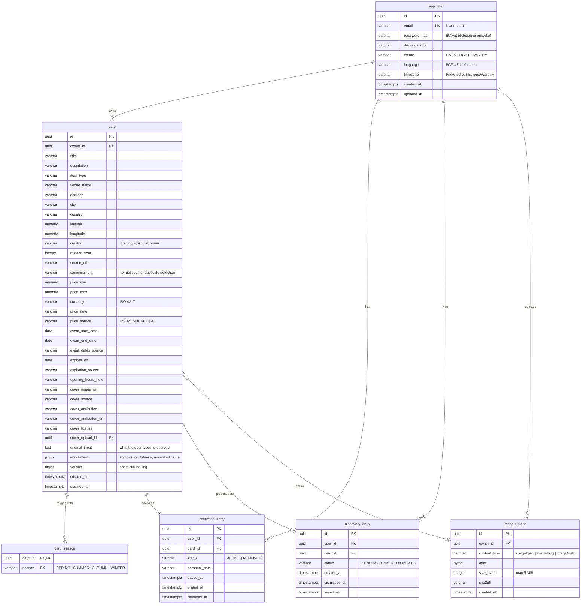

# Data model

PostgreSQL 17, versioned by Flyway (`backend/src/main/resources/db/migration`). Hibernate runs with
`ddl-auto=validate`, so the migrations are the single source of truth.

## Design decisions

### Card metadata vs personal status

`card` holds facts about the place or event. Personal state lives in `collection_entry` (saved,
visited/watched, personal note, removed) and `discovery_entry` (pending, saved, dismissed). This
keeps "I visited it" and "it has expired" independent: visited is `collection_entry.visited_at`,
expiry is derived from `card.expires_on`.

In the MVP, cards are private and owned by the user who created them (`card.owner_id`). Entries
must belong to the card's owner. This is enforced by a composite foreign key
`(card_id, user_id) → card(id, owner_id)`, so a bug cannot attach one user's card to another user's
collection.

### Seasons: normalised relation

`card_season(card_id, season)` with a composite primary key. It was chosen over a PostgreSQL array
because it maps cleanly to a JPA `@ElementCollection` of an enum, a `CHECK` constraint restricts the
values, and "cards in season X" is an indexed `EXISTS` lookup. **Non-seasonal means the card has no
`card_season` rows.** No separate flag can contradict the rows.

### Dates and expiration

| Column | Meaning |
|---|---|
| `event_start_date`, `event_end_date` | When the event runs. `CHECK (end >= start)`. Empty for permanent places. |
| `expires_on` | The last local day the card is relevant. Empty means it never expires. |
| `expiration_source` | `USER`, `SOURCE` (copied from a verified end date), or `AI` (suggested, unverified). `CHECK ((expires_on IS NULL) = (expiration_source IS NULL))`. |
| `event_dates_source`, `price_source` | The same provenance enum for event dates and price. |

There is no "expired" column. Expiry is evaluated against the user's local date at query time
([ADR-0004](adr/0004-query-time-expiration.md)).

Calendar dates use `date`, not `timestamptz`. Exhibitions and festivals are announced as calendar
days in the venue's locale, and expiry is "after the last day" in the user's timezone. Storing an
instant would add a timezone conversion that the source never specified.

### Money

`price_min` and `price_max` are `numeric(10,2)` with `CHECK (price_min >= 0)` and
`CHECK (price_max >= price_min)`. `currency` must match `^[A-Z]{3}$` and is required whenever a
price is present. Free entry is `price_min = 0`. An unknown price is `NULL`, which is different
from free. In Java the values are `BigDecimal` and are never converted to `double`.

### Duplicate prevention

* `UNIQUE (owner_id, canonical_url) WHERE canonical_url IS NOT NULL`. `canonical_url` is the source
  URL with the scheme and host lower-cased, the fragment removed, tracking parameters (`utm_*`,
  `fbclid`, `gclid`) removed, and any trailing slash removed. Creating a second card for the same
  URL returns `409 Conflict` with the existing card's id.
* `UNIQUE (user_id, card_id)` on both entry tables. Saving an already-saved card is idempotent.
  Saving a card that is pending in the inbox moves the inbox entry to `SAVED` and creates (or
  re-activates) the collection entry in the same transaction.
* Drafts include `possibleDuplicates`, which are existing cards with a case-insensitive title match.

### Deletion and restoration policy

| Action | Effect | Reversible |
|---|---|---|
| Remove from collection | `collection_entry.status = REMOVED`, `removed_at = now()`. The card is kept. | Yes, via "Undo" (re-save) |
| Dismiss from Discover | `discovery_entry.status = DISMISSED`, `dismissed_at = now()`. The card is kept. | Yes, via "Restore" |
| Card expires | Nothing is written. The card appears in the Expired archive. | Edit or clear the expiry date |
| Delete card permanently | `DELETE FROM card`, which cascades to seasons and entries. Only available from the card's detail view, with confirmation. | No |
| Delete account | Not in the MVP | — |

### Indexes

| Index | Supports |
|---|---|
| `collection_entry (user_id, status, saved_at DESC)` | Collection grid ("recently added") |
| `discovery_entry (user_id, status, created_at DESC)` | Discover inbox |
| `card (owner_id, expires_on)` | Active vs expired split |
| `card_season (season, card_id)` | Season filter |
| `card USING gin (lower(title) gin_trgm_ops)`, same for `description` | `ILIKE '%term%'` search |
| `card (owner_id, lower(title))` | Duplicate-title hints, alphabetical sort |

### Item types

`PLACE` (park, garden, landmark), `MUSEUM`, `EXHIBITION`, `PERFORMANCE` (opera, theatre, ballet),
`CONCERT`, `FESTIVAL`, `MARKET` (e.g. Christmas markets), `FILM`, `RESTAURANT`, `ACTIVITY`, `EVENT`
(anything else time-bound), `OTHER`. This is a flat enum on purpose, so the MVP has no category
hierarchy. `EXHIBITION`, `PERFORMANCE`, `CONCERT`, `FESTIVAL`, `MARKET` and `EVENT` are
*temporary* types: a verified end date becomes the default expiry. All other types never get a
default expiry.
